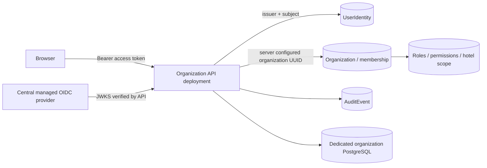
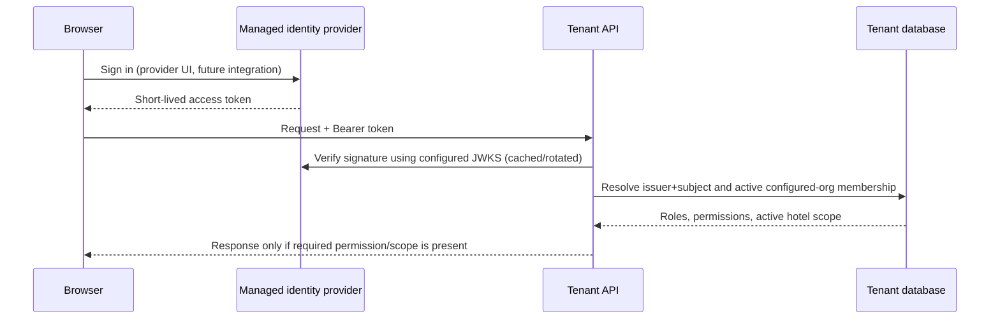

# Identity architecture

Each customer organization has its dedicated API and PostgreSQL deployment. A central identity provider may authenticate a person who belongs to multiple organizations. A request reaches one deployment, whose `TENANT_ORGANIZATION_ID` is configured by deployment provisioning. That value is never selected from a request. The service verifies the token, maps `(issuer, subject)` to `UserIdentity`, then checks active organization membership and local grants.

Security domains remain separate:

- **Platform identity:** provider-authenticated subject and issuer. It does not itself grant HotelOS access.
- **Organization membership:** local membership in the one configured customer organization.
- **Hotel operational authorization:** local organization/hotel role assignments and permission rows.
- **Platform administration:** not implemented; platform staff identities receive no implicit hotel or financial access.

No role, permission, organization selection, hotel ID or email from the browser creates a grant. Role/membership status is read from PostgreSQL on each protected organization request; no authorization cache is currently used. Invalidation is therefore the next request after a database status/role change. Access-token theft remains bounded by token expiry unless provider revocation is separately integrated.

The global bearer guard protects controller routes. Only handlers marked `@Public()` bypass it. Health handlers are public. Swagger is mounted by the existing Express integration and remains governed by `API_DOCS_ENABLED`.
